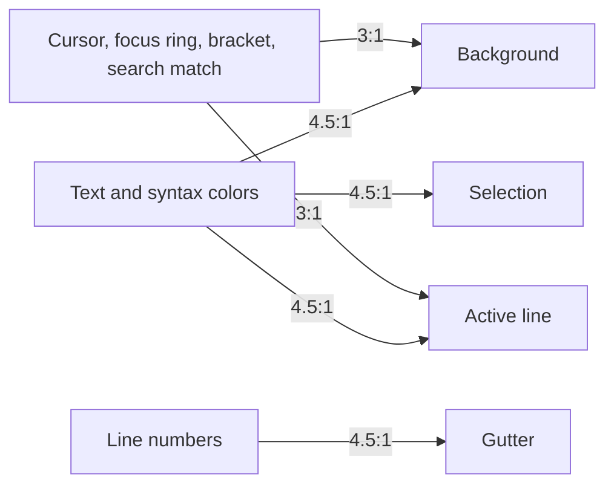

# Accessibility

Since 6.31.0 every theme follows the same accessibility rules. They are enforced by automated tests, so a theme
cannot be published while it breaks one of them.

## Rules

| Rule | Requirement | WCAG 2.2 criterion |
|------|-------------|--------------------|
| Text contrast | Default text and every syntax color reach **4.5:1** against the background, the active line and the selection. | 1.4.3 Contrast (Minimum), AA |
| Line numbers | Gutter text reaches **4.5:1** against the gutter background. | 1.4.3 Contrast (Minimum), AA |
| Non-text contrast | The cursor, the focus ring, the matching-bracket outline and the current search match reach **3:1** against the background (and the active line where they appear on it). | 1.4.11 Non-text Contrast, AA |
| Visible focus | The focused editor shows a ring of at least 2px. | 2.4.7 Focus Visible, AA |
| Forced colors | The focus indicator stays visible in Windows High Contrast and other forced-colors modes. | 2.4.7 Focus Visible, AA |
| Selection | The selection differs from the background (1.2:1) and from the active line (1.15:1), so a selected word on the current line is still visible. | Usability rule of this project |

The ratio is the WCAG relative-luminance contrast ratio. Translucent colors (active line, selection) are first
composited over the editor background, which is what the user sees.

## Which surfaces are checked

Code is read on three surfaces at once: the plain editor background, the highlighted active line and the selection.
A color that passes on the background can fail on a lighter active line or a strong selection, so every text color
is measured against all three and the lowest ratio counts.

## How the palettes were fixed

The original palettes were kept. Colors that already passed are unchanged; a failing color keeps its hue and only its
lightness moves until it reaches the minimum, so each theme keeps its character. Comments stay muted, just readable.
The per-theme changes are listed in [What is new in 6.31.0](../releases/6.31.0.md).

## Pages in this section

| Page | Content |
|------|---------|
| [How Themes Are Tested](testing.md) | The test suites behind the rules and how to run them. |
| [Focus, Selection and Forced Colors](focus-and-forced-colors.md) | Keyboard focus ring, selection visibility and Windows High Contrast. |
| [Contrast Summary](contrast-summary.md) | The lowest ratio of every theme in one table. |

Each [theme page](../themes/README.md) lists its syntax and UI colors with the measured ratios.

## Try it

- [Open in playground](../../playground/contrast-inspector/): the contrast inspector measures the colors of any theme.
- [Open in playground](../../playground/keyboard-focus/): the keyboard-focus sample shows the focus ring and the
  selection while you navigate with the keyboard.

## Your own overrides

The guarantees cover the packaged themes. When you override colors (see
[Overriding Theme Styles](../guides/overriding-styles.md)) or build a theme (see
[Creating a Custom Theme](../guides/custom-theme.md)), check your colors against the same minimums.
